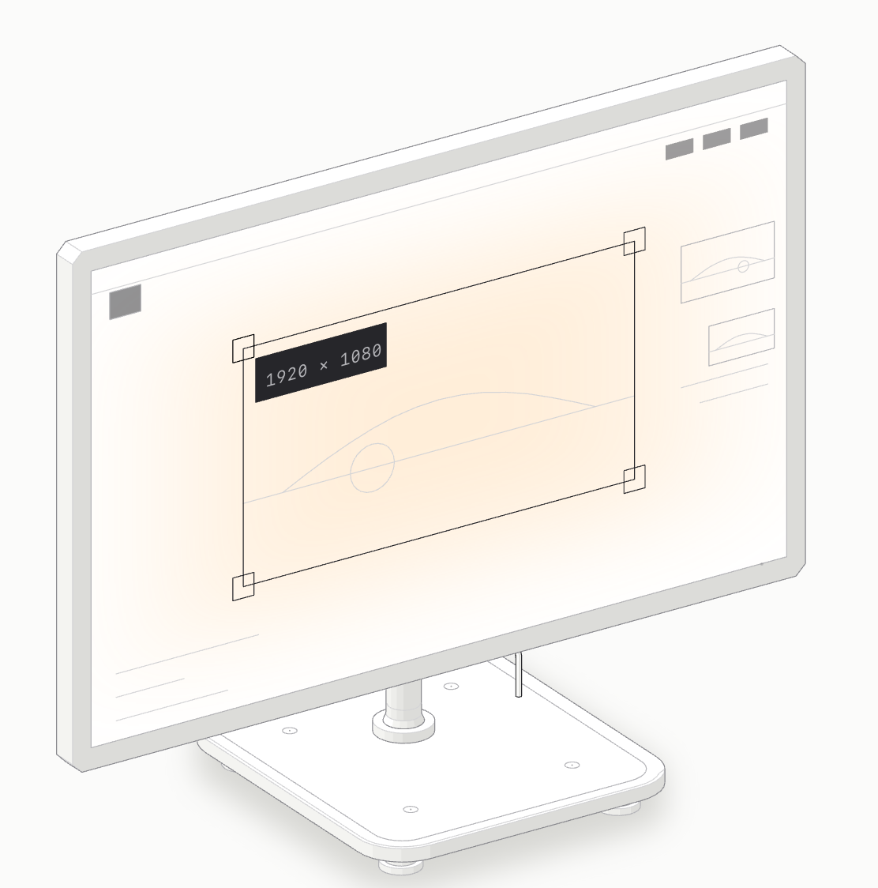

[English](README.md) | [中文](README.zh.md)

# Video Player Resizer

The video is the wrong size. Fix the player, not the page.

<picture>
  <source media="(prefers-color-scheme: dark)" srcset="assets/figures/video-resizer-figure-dark.png">
  
</picture>

## Why this?

Every workaround fixes the wrong thing. Browser zoom scales the text, the chat, the sidebar, everything except your actual complaint. Fullscreen hides the thing you were reading alongside. DevTools works for eleven seconds: you set `width` on the `<video>`, the page shrugs, and on reload it's gone.

The root cause is unglamorous. The box you see is usually not the `<video>`. It's a wrapper: an absolutely-positioned iframe inside a padding-hacked container, a utility class pinning `width: 100%`, a `max-width` clamp, an `aspect-ratio` box. Set `height` on the iframe and nothing moves. That's not a bug in your CSS skills. The control lives one or two ancestors up, and nobody tells you which one.

So this extension stops asking you to find it. It resolves the sizing chain (the outermost ancestor that still tightly wraps the player, plus everything between it and the media element) and writes the size where it actually takes effect.

## What it is

A Manifest V3 browser extension (WXT, MIT licensed) that puts Figma-style drag handles on any web video and resizes the player itself. One permission: `storage`. No host permissions block, no popup window, no account, no analytics. Off on every site until you enable it there.

- Drag any edge or corner to resize the player in place
- Works on `<video>` and embedded player `<iframe>`s, including cross-origin ones
- Manual pick when detection guesses wrong, remembered per site
- Remembers sizes per site, restores the page byte-for-byte on reset

## Key features

- **It resizes the box that matters, not the tag you clicked.** Most tools set `width` on the `<video>` and lose to the wrapper. This climbs to the ancestor that actually controls the rendered box and sizes the whole chain. A padding-ratio embed that ignores `height` on the iframe finally moves.
- **Iframe players work because the overlay never lives inside them.** An `<iframe>` can hold child nodes without rendering them, so DOM injected into the player is invisible. The overlay is a shadow-DOM frame on `<html>` tracking the player's rect, and a full-viewport shield goes up mid-drag so a cross-origin frame can't swallow your pointer events.
- **When detection is wrong, you point.** Hover-and-click picker with `[` / `]` to widen to the parent or narrow back down. Your choice becomes an element path (`:nth-child()` segments, id-anchored, split at shadow boundaries), retried on a 250 to 4000ms ladder for late renders, restored per site. If the path stops resolving, it falls back to detection instead of guessing.
- **Sizes stick without wrecking the page.** Every write uses `!important` and neutralizes the four real overrides: `width: 100%` utilities, `max-width` clamps, `aspect-ratio` / `padding-bottom` ratio boxes, clipping ancestors. Each displaced inline value is recorded, so reset returns the page exactly.
- **It looks like the site, not a widget bolted on.** The frame borrows the page accent (`theme-color` → brand custom properties → link color), normalized in OKLCH so hue survives while lightness stays legible over letterbox black and sky white. Muted brands get floored chroma instead of reading as grey.

## With / without

|                         | Without                                    | With                                             |
| ----------------------- | ------------------------------------------ | ------------------------------------------------ |
| Too-small lecture video | Zoom the whole page or go fullscreen       | Drag the corner; the article stays put           |
| Embedded player         | DevTools edit on the iframe, nothing moves | Sizing chain finds the wrapper that owns the box |
| Wrong video of three    | Re-hover and hope                          | Target list + manual pick, pinned per site       |
| Next visit              | Resize again from scratch                  | Per-site size re-applied automatically           |
| Page after reset        | Leftover inline styles                     | Displaced values restored exactly                |
| Privacy cost            | Accounts, sync servers, analytics          | `storage` only; everything stays in the browser  |

## How it works

Three ideas do the heavy lifting.

### Find the box that actually controls the size

The visible player is usually a wrapper, not the media tag: a padding-hacked container, a `width: 100%` utility, a ratio box. The extension scores candidates by area, on-screen share, and playing state (embeds outrank ads), then climbs to the ancestor that owns the rendered box and sizes the whole chain. Late layout shifts settle before the natural size is remembered; hovering another video retargets unless you've pinned a manual pick.

### Write where the page can't ignore it

Real pages fight back four ways: pinned widths, `max-width` clamps, ratio boxes, clipping ancestors. Every write goes out at top priority with those neutralized, and each displaced value is recorded so reset restores the page exactly. Drags, `Shift` / `Alt` modifiers, `Esc` cancel, double-click reset, and arrow-key nudges all funnel through that same write-and-record path.

### Stay out of the page's way

The overlay floats outside the player, so cross-origin iframes work and page scripts can't trip over it. Detection is a heuristic, so a click-to-pick fallback is built in: your choice is remembered per site, retried against late renders, and dropped back to automatic when the page stops matching. Off everywhere until you opt a site in; settings sync, measured sizes stay local.

### Design decisions

| Choice                                    | Why                                                                                                                   |
| ----------------------------------------- | --------------------------------------------------------------------------------------------------------------------- |
| Overlay outside the player, not inside it | Injected DOM never renders inside an iframe; tracking the rect from outside works everywhere                          |
| Priority writes + displaced-value journal | Plain inline styles lose to utility classes; the journal makes reset exact instead of "close enough"                  |
| Off by default, per-site opt-in           | Video sites, calls, and feeds all have their own layout opinions; no blocklist covers them, a default-off switch does |
| Page-less action (no popup)               | The controls live in the page; the toolbar icon just toggles them                                                     |
| No host permissions, no analytics         | Detection runs locally; the only permission is `storage`                                                              |

## Quick start

**Use it (4 steps):**

1. Install the unpacked build (`bun run dev`) or the store ZIP, open any page with video.
2. Click the toolbar icon → **Enable here**. The overlay appears on hover from now on for this host.
3. Drag a handle. `Shift` inverts aspect lock, `Alt` disables snapping, double-click resets.
4. Wrong box? Open **More** → **Select element**, click the right box. **Use automatic** hands it back.

**Develop:**

```bash
bun install
bun run dev        # unpacked build in a fresh profile
bun run test       # 8 suites: detector, sizing, overlay, picker, toolbar, theme, storage, paths
bun run compile    # tsc --noEmit
bun run build
bun run verify:release  # tests + compile + build + store-package checks
```

Manual cases live under `examples/`: serve over local HTTP, enable the host, drag. `bun run package:chrome` writes the uploadable ZIP under `.output/`.

That said, it won't fix sites that re-assert layout every frame, and a same-origin subframe pick can't be addressed on revisit (it still works for the session). Detection is a heuristic; the picker is the honest fallback, not a failure mode.

## License

MIT, see [LICENSE](LICENSE). Privacy details: [PRIVACY.md](PRIVACY.md).
